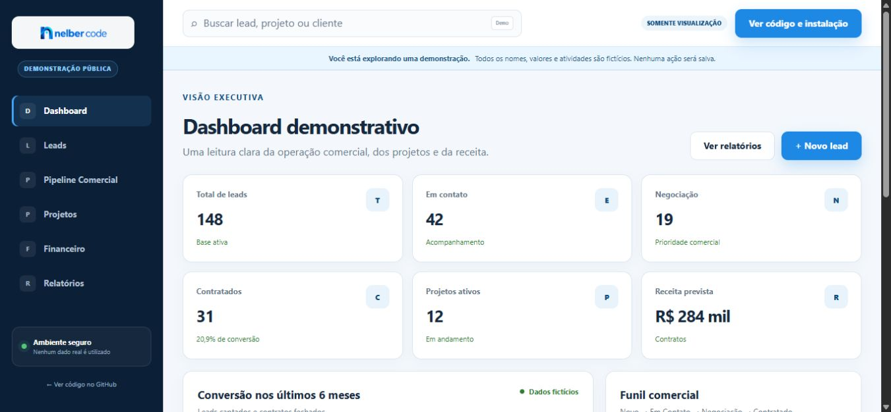

# Nexora CRM

CRM web de Ricardo Nelber para organizar leads, negociações, projetos e informações financeiras comerciais.
Projeto de portfólio em desenvolvimento, com servidor PHP e armazenamento MySQL/MariaDB.

**[Abrir demonstração](https://nexora-crm-ricardo-demo.rick00-oo.chatgpt.site)** ·
**[Portfólio do autor](https://ricard0-o.github.io/ricardonelberdev/)**

## Demonstração

A demonstração pública apresenta a interface de dashboard, leads, pipeline, projetos,
financeiro e relatórios. Os nomes, valores e atividades são fictícios.
É uma demonstração de navegação e explicação: não autentica usuários, não grava mudanças,
não recebe uploads e não realiza pagamentos. O servidor completo está neste repositório.
Não use dados pessoais no ambiente demonstrativo.



## Funcionalidades do código

- Autenticação, perfis e separação de registros por organização.
- Cadastro, consulta, validação e importação de leads por JSON/planilha.
- Pipeline com etapas comerciais.
- Projetos com progresso, prazos e valores.
- Visões financeiras, relatórios, busca e trilha de auditoria.
- Código de integração com Mercado Pago, **opcional e não validado para cobranças reais nesta publicação**.

## Requisitos

- PHP **8.3 ou superior**, conforme `composer.json`.
- Extensões PDO/MySQL, JSON, cURL, mbstring e fileinfo. GD é necessário para recursos de tratamento de imagens.
- Composer 2.
- MySQL 8 ou MariaDB compatível. O baseline SQL desta versão é para MySQL/MariaDB;
  PostgreSQL não possui uma instalação equivalente validada.
- Navegador moderno. Apache/XAMPP é uma alternativa local, desde que o PHP atenda à versão mínima.

## Instalação

1. Clone o repositório e instale as dependências:

   ```sh
   git clone https://github.com/Ricard0-o/nexora-crm.git
   cd nexora-crm
   composer install
   ```

2. Copie `.env.example` para `.env` (`Copy-Item .env.example .env` no PowerShell).
   Configure `DB_HOST`, `DB_PORT`, `DB_DATABASE`, `DB_USERNAME` e `DB_PASSWORD` para
   um banco **novo e vazio**, criado por você. Use um usuário com acesso somente a esse banco.
   Gere uma chave própria com `php -r "echo bin2hex(random_bytes(32));"` e preencha `APP_KEY`.
   Para desenvolvimento, mantenha `APP_URL=http://localhost:8080`, `APP_DEBUG=false`
   e `SESSION_SECURE=false`. Em HTTPS, use `SESSION_SECURE=true`.

3. Instale a estrutura vazia:

   ```sh
   php scripts/install.php
   ```

   O instalador recusa bancos que já tenham tabelas. Não importe as migrações antigas
   em lote; veja [o histórico do esquema](database/migrations/README.md).
   Nenhum usuário, senha universal, contato ou cliente acompanha o baseline.

4. Crie o primeiro administrador. No PowerShell:

   ```powershell
   $env:CRM_ADMIN_EMAIL = Read-Host 'E-mail do administrador'
   $senhaAdmin = Read-Host 'Senha própria: 12+ caracteres, maiúscula, minúscula e número' -AsSecureString
   $env:CRM_ADMIN_PASSWORD = [System.Net.NetworkCredential]::new('', $senhaAdmin).Password
   php scripts/create-admin.php
   Remove-Item Env:CRM_ADMIN_PASSWORD
   Remove-Item Env:CRM_ADMIN_EMAIL
   ```

   No Linux/macOS, defina as mesmas variáveis no ambiente sem salvar a senha no código
   ou no histórico do shell. O script funciona somente por CLI e recusa instalações com usuários existentes.

5. Inicie para desenvolvimento:

   ```sh
   php -S localhost:8080 -t public public/index.php
   ```

   Abra `http://localhost:8080/login`. O servidor embutido é para desenvolvimento;
   em implantação configure o document root **somente em `public/`**, HTTPS e permissões de `storage/`.

## Como funciona

```text
Navegador → public/index.php → Router/Middleware → Controller
                                                   ↓
                                                Service
                                                   ↓
                                             Repository → PDO → MySQL
```

`app/` reúne regras e acesso a dados; `resources/views/`, as telas; `public/`, os
arquivos públicos; `database/install.sql`, o esquema inicial; `storage/`, arquivos
locais de execução, ignorados pelo Git. A demonstração em `demo/` é independente do servidor.

## Verificações

```sh
composer validate --strict
composer check
composer test
php scripts/build-demo.php
```

A integração contínua usa PHP 8.3 e um MySQL isolado para instalar a estrutura,
criar um administrador fictício e verificar a tela de login. Os testes unitários
existentes cobrem validação de leads e assinatura de webhook; não representam cobertura completa do produto.

## Configurações, segurança e limitações

- `.env.example` documenta as opções; `.env`, dados, backups, logs e uploads não são publicados.
- Contatos da página institucional são exemplos e devem ser configurados antes de uso comercial.
- A integração de pagamentos fica sem credenciais. Não há cobrança disponível na demonstração.
- Revise backup, restauração, permissões, isolamento por organização e legislação aplicável antes de uso com clientes reais.
- Esta publicação é uma cópia de código: não contém banco operacional ou histórico Git dos ambientes pessoais.

## Autoria e licença

Ricardo Nelber — [GitHub](https://github.com/Ricard0-o).
Código autoral com direitos reservados; consulte [LICENSE](LICENSE) e
[componentes de terceiros](THIRD_PARTY_NOTICES.md).
Veja também [CONTRIBUTING.md](CONTRIBUTING.md), [SECURITY.md](SECURITY.md) e [CHANGELOG.md](CHANGELOG.md).
